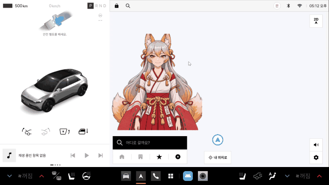

# Vroomi — Pleos Voice Companion

## Installation

Vroomi is an in-car voice companion for Pleos: it reacts to vehicle signals (brake, turn signal, and more) in a character's voice. **Install the release APK on a Pleos Connect emulator to try it.** You do not need to build anything (a public clone cannot build the app, see [Building from source](#building-from-source-team-only)).

**At a glance**

1. Download `DrivePersona_Vroomi_release.apk` from [GitHub Releases](https://github.com/DrivePersona/Vroomi/releases/latest).
2. Cold-boot the Pleos Connect emulator and install the APK.
3. Grant the overlay permission, clear the app's "stopped" state, then **shut the emulator down and cold-boot it once more**.
4. On the parked screen (gear P) the **fox shrine maiden** appears. Press the brake in the Virtual Console and the fox speaks.

**Good to know**

- The app has no screen (Activity) and no launcher icon. Installing it does not start it. It starts as a background service **when the emulator boots** and shows the character over the parked screen. That is why one more boot is needed after installing.
- This APK contains candidate characters and voices that are not yet approved for commercial use. It is provided for review and demonstration only.
- Verification level: Pleos Connect emulator only. It has not been verified in a real vehicle, and nobody has listened to the audio (verified up to playback start and finish events). The emulator draws the character as a 2D preview.
- The app's UI text and log lines are in Korean. They are quoted as-is below, with English translations.

### Demo

[](docs/evidence/videos/pleos-overlay-demo-2026-11-18.mp4)

*Click the animation for the full 20-second recording (MP4, 25 MB). Recorded on the Pleos Connect emulator on 2026-11-18.*

[Character signal videos](docs/evidence/videos/character-signals/README.md) show the brake, turn-signal and touch sequences for the fox shrine maiden, VTuber and Seori.

What the recording shows, in order:

1. The character stands over the parked (gear P) navigation map, with the vehicle cluster on the left.
2. **Long-press** the character: a floating menu opens beside it (change character, collection, hear lines, settings, close).
3. Open **Settings**: a compact sheet with **character size** (smaller / larger), the opening greeting switch, and reset position.
4. Change the size: the character grows and shrinks in place.

This recording uses an **internal build** with the LivLiv 2.5D character overlay (opt-in, internal only). It is not the public release APK, which draws the character as a 2D preview. The artwork is a candidate whose commercial-use rights are not yet confirmed, so it is shown for review only (see [Asset policy](#asset-policy)). Emulator only: not verified in a real vehicle.

### Test environment

| Item | Value |
| --- | --- |
| Emulator | Pleos Connect AVD **2.1.0** (Android 14 / API 34, Automotive). Setup: section 7 of [PLEOS_PLATFORM_FINDINGS](docs/platform/PLEOS_PLATFORM_FINDINGS.md) (Korean) |
| Screen | 2560×1440, landscape |
| Android user | `10` (check with `adb shell am get-current-user`) |
| App | package `com.example.voicecompanion`, version 0.1.0, minSdk 28 / targetSdk 35 |
| APK | `DrivePersona_Vroomi_release.apk` from [GitHub Releases](https://github.com/DrivePersona/Vroomi/releases/latest) (the SHA-256 is in the release notes) |
| Tools | `adb` (Android platform-tools) and a web browser |

### Steps

**1. Download the APK.** Get `DrivePersona_Vroomi_release.apk` from [GitHub Releases](https://github.com/DrivePersona/Vroomi/releases/latest) and check that its SHA-256 matches the one in the release notes.

```bash
shasum -a 256 DrivePersona_Vroomi_release.apk      # Windows: certutil -hashfile DrivePersona_Vroomi_release.apk SHA256
```

**2. Cold-boot the emulator** (do not use a snapshot). Replace the AVD name with yours.

```bash
emulator -avd Pleos_Connect_v2_1_0 -no-snapshot -no-boot-anim
adb shell am get-current-user    # usually 10
```

**3. Install the APK and grant the overlay permission.**

```bash
adb install -r --user 10 DrivePersona_Vroomi_release.apk
adb shell appops set --user 10 com.example.voicecompanion SYSTEM_ALERT_WINDOW allow
adb shell cmd appops write-settings
```

**4. Clear the "stopped" state.** Right after installation the app is in Android's "stopped" state and cannot receive the boot signal. After these commands, `stopped=false` must be printed.

```bash
adb shell am broadcast --user 10 -a androidx.profileinstaller.action.BENCHMARK_OPERATION -n com.example.voicecompanion/androidx.profileinstaller.ProfileInstallReceiver --es EXTRA_BENCHMARK_OPERATION DROP_SHADER_CACHE
adb shell "pm dump com.example.voicecompanion | grep -E 'User 10: ceData' | grep -o -E 'stopped=[a-z]+'"
```

**5. Wait 15 seconds**, then save and shut the emulator down, and cold-boot it again. Android writes the cleared state to disk late. If you shut down right away, the app is back in the stopped state after boot and the service never starts. Do not use `adb reboot` on this emulator (see the [E2E guide](docs/guides/PLEOS_VIRTUAL_CONSOLE_E2E.md), Korean).

```bash
adb shell sync
adb emu kill
emulator -avd Pleos_Connect_v2_1_0 -no-snapshot -no-boot-anim
```

**6. Check that the service started and the fox appeared** (a few seconds after boot finishes).

```bash
adb logcat -d -s VoiceCompanionService VoiceCompanion
adb shell "dumpsys window | grep -c VoiceCompanionCharacterOverlay"
```

If the two log lines below are present and the second command prints a number greater than 0, it works. The fox shrine maiden stands on the navigation map. A speech bubble reading "길게 누르면 메뉴가 열려요" ("Long-press to open the menu") may appear next to her.

```text
VoiceCompanionService: runtime started; action=com.example.voicecompanion.action.START_BACKGROUND
VoiceCompanion: overlay sync: VrOverlayInput(enabled=true, stationary=true, settingsVisible=false, readyCharacter=true, overlayPermissionGranted=true) character=ai.meshy.fox
```

**7. Open the Virtual Console, send a brake signal, and check the reaction.** The console only applies your input while a browser has it open.

```bash
adb forward tcp:8088 tcp:8088
```

In a browser open `http://127.0.0.1:8088/` and raise Brake Pedal from 0% to **about 70%** ([E2E guide](docs/guides/PLEOS_VIRTUAL_CONSOLE_E2E.md), section 3, Korean). If you only tap briefly and the value stays at a few percent, the app receives the input but does not speak. You can also send the same signal from the command line (with the console open in a browser):

```bash
curl -X PUT "http://127.0.0.1:8088/vehicle/controls?brake=70"
```

Then read the app's reaction:

```bash
adb logcat -d -s VoiceCompanion
```

```text
반응 BRAKE: 말하기 요청 "오냐, 천천히 가거라."
반응 음성 BRAKE: 재생됨
```

The log is in Korean, as the app writes it. The fox says "오냐, 천천히 가거라." (roughly "Very well, go slowly."), and `재생됨` ("played") means playback started. The fox has no brake gesture yet, so the character itself stays still. To try again, set the brake back to 0%, wait 10 seconds (the cooldown), and raise it again.

| Symptom | What to check |
| --- | --- |
| The install in step 3 fails with a signature conflict | A same-package app signed with a different key is already installed. Run `adb uninstall --user 10 com.example.voicecompanion` and install again. |
| No logs in step 6 | Confirm `stopped=false` in step 4, wait 15 seconds, and cold-boot again as in step 5. |
| The service started but the fox is not visible | Make sure the gear is P (parked) and that you granted the overlay permission in step 3. In the `overlay sync` log line, `stationary`, `readyCharacter`, and `overlayPermissionGranted` must all be `true`. |
| Input is logged but the app does not speak | Check that the brake went from 0% to about 70% and that the 10-second cooldown has passed. |
| Anything else | See the troubleshooting order in the [E2E guide](docs/guides/PLEOS_VIRTUAL_CONSOLE_E2E.md) (Korean). |

### Web simulator (optional: reaction rules only, no Pleos)

This is a tool for checking the reaction rules (priority, cooldown, parked-state gate), not the real app. It runs from a plain clone and needs Node.js 20 or later and Python 3.

```bash
git clone https://github.com/DrivePersona/Vroomi.git
cd Vroomi
node --test                      # all tests must pass
python3 -m http.server 5183      # use python on Windows. Then open http://localhost:5183
```

Press the **브레이크 밟기** ("Press the brake") button. The reaction log then shows `브레이크 밟기 → 말하기 요청 "으앗!" · 재생됨` ("Press the brake → speak request "Whoa!" · played").

## About

Vroomi (by DrivePersona) is an in-car voice companion for Pleos. It converts vehicle events such as braking, turn signals, drive-mode changes, and tire checks into concise character-led voice feedback.

This repository is the public review surface for the application: vehicle reaction rules, UI/UX, simulator, and integration contracts are visible here. Approved voice and character assets are intentionally isolated in private SDK repositories.

### Direction: LivLiv replaces GLB (2026-11-18)

Characters are moving from 3D GLB packs to **LivLiv** 2.5D characters drawn in an Android WebView. The GLB approach is retired; the code is removed step by step. See [decision 0002](docs/decisions/0002-livliv-replaces-glb.md) and the [LivLiv overlay](docs/architecture/LIVLIV_OVERLAY.md) for the structure, current state, and what is still open.

## Repository map

| Repository | Visibility | Purpose |
| --- | --- | --- |
| `DrivePersona/Vroomi` | Public | This app, web simulator, design documents, and pack integration contracts |
| `DrivePersona/voice-pack-sdk` | Private | Voice-pack runtime AAR and approved audio packs |
| `DrivePersona/character-pack-sdk` | Private | GLB character-pack runtime AAR and packs (being replaced by LivLiv) |
| `DrivePersona/livliv-pack-sdk` | Private | LivLiv (2.5D) pack validation and WebView renderer AAR, and pack data |

## Building from source (team only)

You do not need this to try the app: use the APK as described in [Installation](#installation). A public clone **cannot build the Android app**. Both variants depend on the private `voicepack-runtime` and `characterpack-runtime` packages on GitHub Packages, which answer `401 Unauthorized` without team credentials. The build variants below matter only to the team:

- `reviewDebug` contains no commercial voice or character assets. It remains the safe presentation build.
- `internalRelease` resolves the private AARs from GitHub Packages. The APK on the Releases page is this variant. It includes candidate characters and voices that are not yet approved for commercial use and is provided for review and demonstration only. Only internal builds show candidate characters (the fox shrine maiden, `ai.meshy.fox`, is the first-run character); the `review` build follows the release roster.

## Documentation

Start at the [documentation map](docs/README.md) (AI agents: [AGENTS.md](AGENTS.md)). It is organized top-down by area: overview, product, architecture, platform, content, guides, evidence, decisions, and log.

## Product and user-flow design

- [Product requirements (PRD v2)](docs/product/PRODUCT_REQUIREMENTS.md) — product scope, vehicle input contract, safety policy, release criteria, and current constraints.
- [User flows v2](docs/product/USER_FLOWS.md) — WindowManager overlay-first startup, avatar gestures, 5+11 acquisition, dialogue, and driving lock.
- [Wireframes v2](docs/product/WIREFRAMES.md) — Pleos HMI stays visible while avatar-anchored floating controls and compact overlay sheets handle companion actions.
- [Interactive overlay-first mockup v2](docs/product/mockups/voice-companion-flow.html) and [PNG preview](docs/product/mockups/voice-companion-flow.png) — real Pleos HMI frame/vehicle area with a schematic map underlay replacing the old debug Activity pane; approved roster assets remain unassigned.
- [Project and PR history](docs/log/PROJECT_AND_PR_HISTORY.md) — repository roles, merged PR inventory, open work, and evidence gaps across all three repositories.

Package releases dispatch `voicepack-published` or `characterpack-published` with a version, or `packs-published` with both package versions. The protected `internal-build` workflow resolves private AARs, runs roster/unit validation, assembles the internal release APK, records supplied content metadata in `docs/content/PACK_RELEASES.md`, and only then opens or refreshes a reviewable PR. Applied versions are a no-op. It never auto-merges. Keep `DRIVEPERSONA_PACKAGES_USER`, `DRIVEPERSONA_PACKAGES_TOKEN`, and the fine-grained `DRIVEPERSONA_SYNC_TOKEN` in the protected environment; the sync token needs `Contents: write` and `Pull requests: write` for this repository. The private SDK publish workflows use the same sync token only to send the dispatch.

The protected `internal-android` CI job runs only after main receives a reviewed change and `INTERNAL_PACKAGES_ENABLED` is true. Public pull-request CI never receives package credentials.

## Asset policy

No Qwen model cache, reference voice, raw audition, unverified reference-derived character, or approved production pack binary is committed to this public repository.
