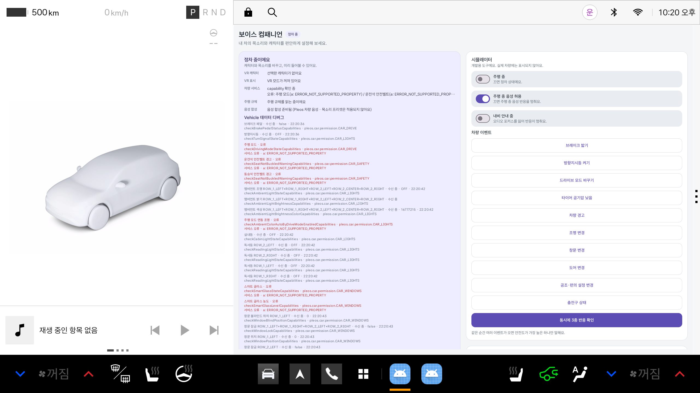
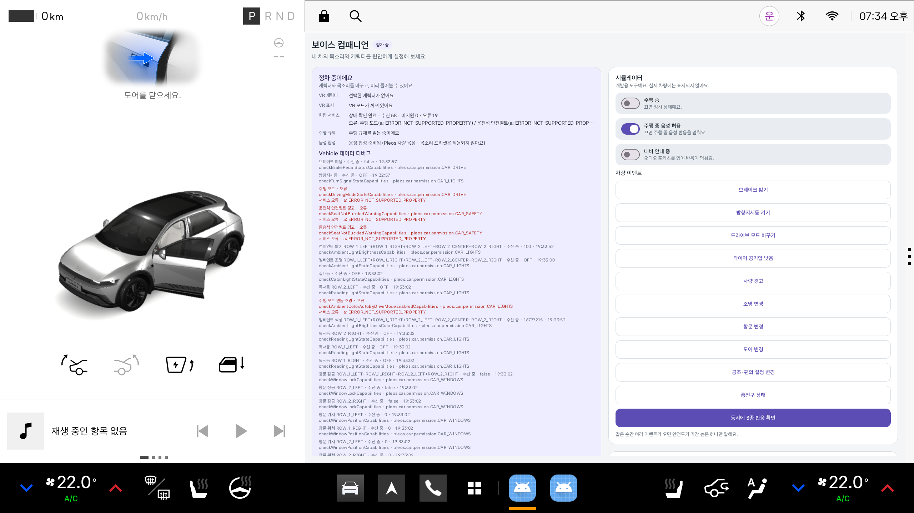
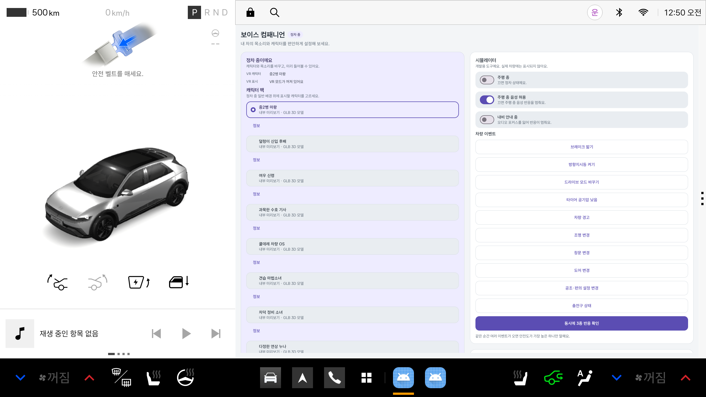
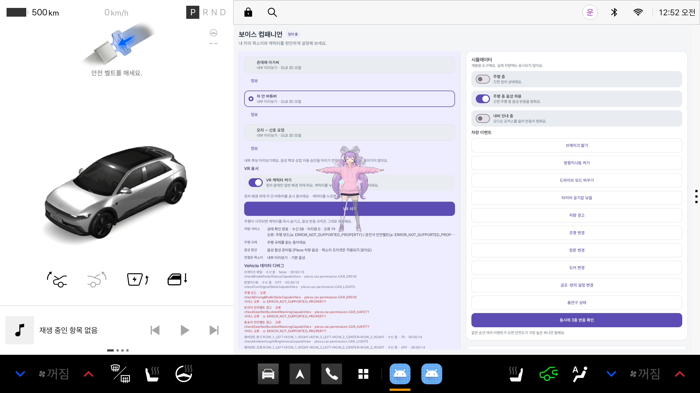

# Pleos AVD UI 검증 증적

검증일: 2026-11-04  
대상: `Pleos_Connect_v2_1_0` (사용자 10, 콜드 부팅)  
APK: 메인 통합 브랜치의 `reviewDebug`

## 확인한 흐름

1. 최종 통합 APK를 Pleos AVD에 설치했다.
2. `com.example.voicecompanion.review/.ui.MainActivity`를 사용자 10으로 실행했다.
3. 앱이 검은 화면 없이 Pleos 차량 화면 위에 표시되는지 확인했다.
4. 차량 서비스 구독 상태와 Vehicle 데이터 디버그 영역이 표시되는지 확인했다.
5. Virtual Console의 도어 상태 변경이 앱 콜백과 디버그 기록으로 들어오는지 확인했다.

## UI 캡처

최종 통합 APK 실행 화면. Pleos 차량 화면, 정차 상태, 차량 데이터 디버그 영역과 각 capability 수신 상태가 표시된다.

차량 도어 이벤트 검증 화면. Virtual Console에서 Front Left Door를 열었을 때 Pleos 화면에 도어 상태가 표시되고 앱의 수신 카운터가 증가했다.

## 결과

| 항목 | 결과 |
| --- | --- |
| 앱 설치 | 통과 |
| Activity 실행 | 통과 |
| 검은 화면/초기 렌더 지연 회귀 | 재현되지 않음 |
| 차량 capability 구독 | 통과·미지원 항목은 상태에 표시 |
| Virtual Console 도어 이벤트 | 콜백 수신 확인 |
| 실차 검증 | 미실시 |
| 사람 귀로 음성 청취 | 미실시 |

에뮬레이터가 제공하지 않는 드라이브 모드·안전벨트 등은 실패로 처리하지 않고 `ERROR_NOT_SUPPORTED_PROPERTY`로 기록한다. 이 문서는 UI 증적을 남기기 위한 검증 기록이며, 실차 적합성 승인을 의미하지 않는다.

## 차량 이벤트의 원천

차량 이벤트 검증은 앱 내부의 개발용 시뮬레이터 버튼이 아니라 Pleos Connect Virtual Console에서 수행한다.

1. `adb forward tcp:8088 tcp:8088`을 실행한다.
2. 브라우저에서 `http://127.0.0.1:8088/`을 연다.
3. Virtual Console의 Brake Pedal, Turn Signal, Door Position 등 실제 Pleos 카드 값을 변경한다.
4. 앱에서는 Pleos Vehicle SDK 콜백, Vehicle 데이터 디버그 기록, 음성·캐릭터 반응만 확인한다.

앱 내부 시뮬레이터 패널은 웹·오프라인 규칙을 확인하는 개발 도구이며, Pleos 차량 인터페이스 수신 증적에는 사용하지 않는다.

## 내부 후보 캐릭터 미리보기

`internalDebug`는 출시 로스터가 비어 있을 때에도 승인 전 후보 GLB를 `내부 미리보기`로 표시한다. 이 경로는 후보 캐릭터의 선택·렌더링·오버레이 배치만 확인하기 위한 것이며, 후보 manifest의 `voicePackId=null`과 `commercialUse=false`를 유지한다. 음성은 기본 Pleos 음성을 사용하고, 출시 빌드의 로스터에는 자동 등록하지 않는다.

후보 목록에서 `차 안 버튜버`를 선택한 뒤 `VR 캐릭터 켜기`와 `VR 시작`을 눌러 GLB 오버레이를 확인했다.

