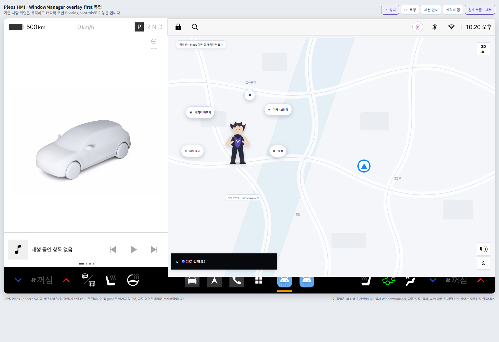

# Voice Companion 와이어프레임 v2 — WindowManager overlay-first

**기준:** 2026-11-05
**기본 화면:** Pleos 차량/HMI가 기존처럼 전면에 남는다. 별도의 컴패니언 Activity 화면은 상시 표시하지 않는다.

## 화면 원칙

- 캐릭터는 현재 Pleos 화면 위에 투명 WindowManager overlay로 표시한다.
- 캐릭터 주변의 메뉴·보관함·가챠·대사·설정도 floating controls 또는 compact overlay sheet다.
- 운전석/내비/차량 설정/상태 표시/시스템 바 등 Pleos 소유 영역을 대체하거나 가리지 않는다.
- 주행 또는 차량 상태 미확인 시 캐릭터와 수동 조작 overlay를 숨긴다.
- 이 문서의 시연 이미지는 실제 Pleos Connect HMI 캡처를 기반으로 하며, 기존 앱 pane 영역은 지도 홈 배경의 스케매틱으로 덮어 컴패니언 화면이 뒤에 없음을 표현한다. 스케매틱 지도는 제품 UI 실측이라고 주장하지 않는다.



## 상태별 와이어프레임

### 정차 · 캐릭터만 표시

```text
┌──────────────────────── Pleos HMI 현재 화면 유지 ────────────────────────┐
│ 차량/지도/상태/상단 바는 Pleos 소유                                     │
│                                                                          │
│                                      [캐릭터 GLB]                         │
│                                      (짧은 탭=TOUCH)                      │
│                                                                          │
│                                                                          │
├──────────────────────── Pleos 시스템 바 유지 ────────────────────────────┤
└──────────────────────────────────────────────────────────────────────────┘
```

### 캐릭터 길게 누름 · floating controls

```text
                         [캐릭터 바꾸기]     [가챠/보관함]
                                 \             /
                                  [캐릭터 GLB] ─ [X]
                                 /             \
                           [대사 듣기]        [설정]
```

버튼은 캐릭터 머리/모델 bounds를 기준으로 배치하고 화면 가장자리와 시스템 영역 안쪽으로 제한한다. 캐릭터를 가리거나 메뉴가 화면 밖으로 나가지 않게 한다.

### 메뉴 선택 · compact overlay sheet

```text
┌──────────── 현재 Pleos 화면 ────────────────────────────────────────────┐
│                                    [캐릭터]       ┌─ 선택한 항목 ───────┐│
│                                                   │ 기본 5 / 보유 목록 ││
│                                                   │ 후보 01  선택      ││
│                                                   │ 후보 02  선택      ││
│                                                   │ 후보 03  잠김      ││
│                                                   │              [X]   ││
│                                                   └────────────────────┘│
└──────────────────────── Pleos 시스템 바 ───────────────────────────────┘
```

sheet는 앱 화면 전체로 바뀌지 않는다. 캐릭터 인접 safe area에서 콘텐츠에 필요한 크기만 사용하고, 바깥 탭 또는 X로 닫는다.

## 메뉴와 화면 내용

| Floating action | overlay 콘텐츠 | 제한 |
| --- | --- | --- |
| 캐릭터 바꾸기 | 기본 5 + 보유 가챠 캐릭터 목록 | 선택 캐릭터에 대응 voicePack 자동 연결 |
| 가챠/보관함 | 첫 풀 11개와 보유 상태, 결과 확인 | 결제·확률·재화 정책 결정 전 비노출 |
| 대사 듣기 | 캐릭터별 고정 대사 목록 | 행 탭 시 WAV 재생, 대사 편집 없음 |
| 설정 | 자동 인사, 정차 중 표시 등 짧은 설정 | 복잡한 설정은 별도 UX 결정 전 추가 금지 |
| X | 현재 menu/sheet 닫기 | 캐릭터 overlay는 유지 |

## Pleos 화면과 overlay 계층

| 요소 | 담당 계층 | 설계 기준 |
| --- | --- | --- |
| 차량, 지도/내비, 주행/기어 상태, 시스템 바 | Pleos HMI | 기존 화면을 그대로 유지 |
| 캐릭터 GLB | WindowManager overlay | 정차 상태 확인 후 표시 |
| floating buttons와 compact sheets | 같은 overlay-first 경험 | 캐릭터 anchor 중심, safe bounds 제한 |
| 설정/복구 Activity | Android Activity | 사용자가 명시적으로 요청할 때만 진입 |

## 제스처 상태 규칙

| 제스처 | 결과 | 중복 실행 금지 |
| --- | --- | --- |
| 짧은 탭 | TOUCH 대사/승인 동작 | 홀드가 확정되면 TOUCH 취소 |
| 제자리 길게 누름(초기 500ms) | 메뉴 열기 | TOUCH 재생 금지 |
| 이동 임계값 초과 드래그 | 캐릭터 이동/위치 저장 | 탭/메뉴 실행 금지 |
| X / 바깥 탭 | menu 또는 sheet 닫기 | 캐릭터 overlay 종료 금지 |
| 주행/상태 미확인 | overlay 숨김 및 입력 잠금 | 어떤 수동 동작도 수행 금지 |

## 인터랙티브 목업

[WindowManager overlay-first 목업](mockups/voice-companion-flow-v2.html)에서 정차/주행, 시작 인사 상태, 짧은 탭, 길게 누름, 캐릭터 선택, 가챠 시연, 대사/설정 sheet를 확인할 수 있다. 목업은 Pleos Virtual Console, Android WindowManager, 실제 WAV 또는 소유권을 제어하지 않는다.
