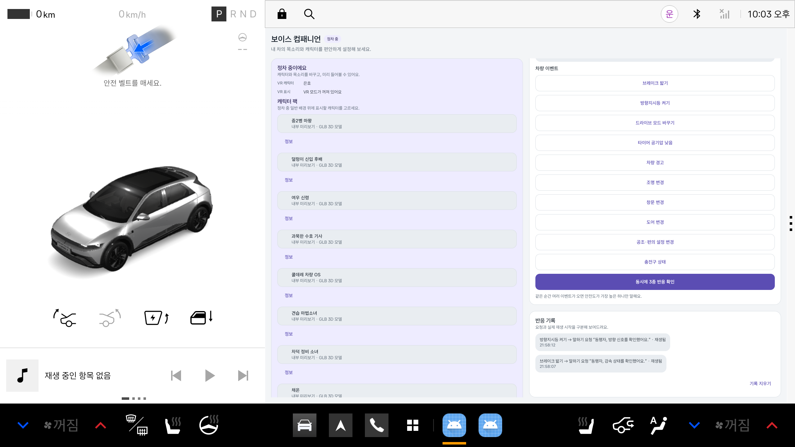
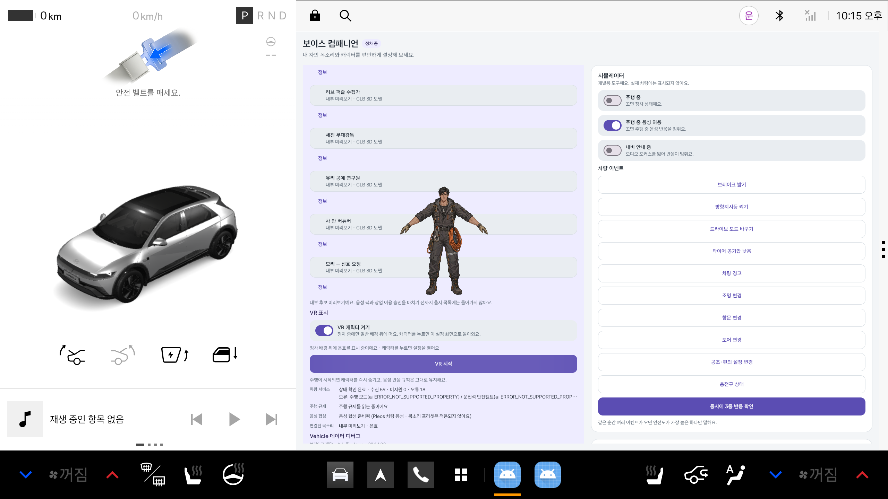
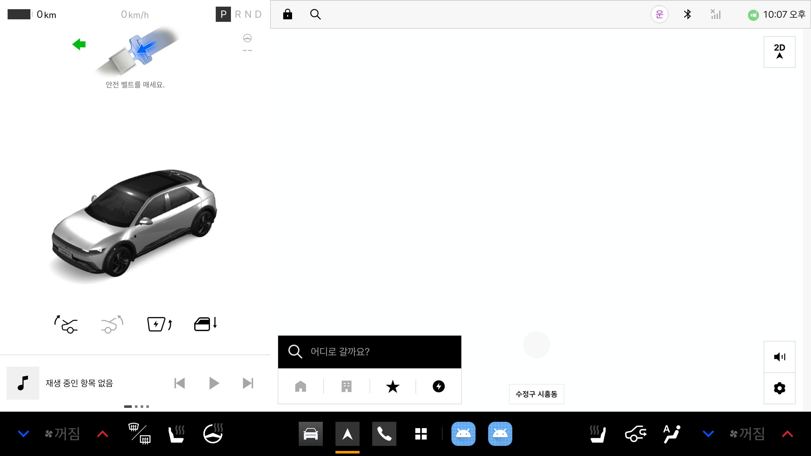

# Internal VoiceDesign preview: Pleos AVD validation

Captured on 2026-11-05 with Pleos Connect AVD `emulator-5554` (Android user 10). Vehicle inputs were sent directly to the existing Virtual Console backend through the ADB-forwarded REST API at `127.0.0.1:8088`; neither the browser UI nor the app's developer event buttons were used to create these signals.

| Vehicle input | Backend readback | App reaction record |
| --- | --- | --- |
| Brake 70% | `brake_pct=70`, then reset to 0 | `동행자, 감속 상태를 확인했어요.` — playback-start record `재생됨` |
| Left turn signal | `BlinkLeft`, then reset to `Off` | `동행자, 방향 신호를 확인했어요.` — playback-start record `재생됨` |

The selected internal candidate was 은호 (`ai.meshy.nra-eunho`) paired with `ai.meshy.nra-eunho.voicedesign`. The internal APK contained all 23 new VoiceDesign packs and 253 WAV files: one greeting plus ten event clips per pack. `WARNING` and `ENERGY_LOW` do not have per-character clips in this set and remain neutral/safety output slots.

## Captures

Direct Virtual Console event results recorded by the app:

Selected 은호 GLB shown in the Pleos display with VR enabled:

Pleos may foreground its EVS/DrivingView surface for a turn signal, covering the app and character overlay:

## Scope and limitations

- These are internal audition assets with `commercialUse=false`; they are not release-approved packs.
- `재생됨` confirms the app's playback-start record. This capture is not a human listening or audio-quality review.
- Vehicle input and voice selection were verified, but event-specific GLB gesture changes could not be visually confirmed while Pleos EVS/DrivingView takes the foreground.
