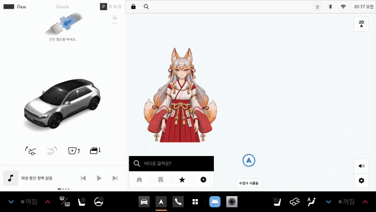
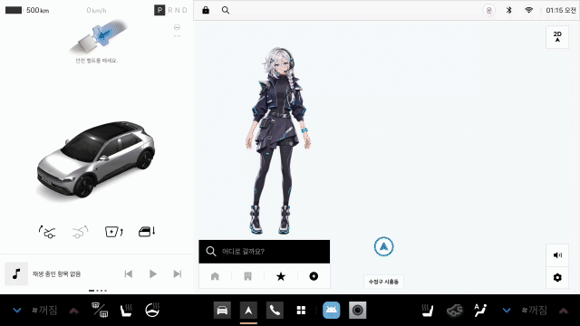
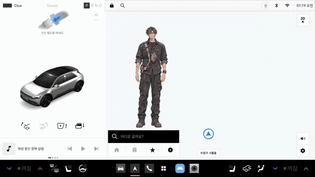

# 캐릭터별 신호 시연 영상

Vroomi 내부 빌드의 LivLiv 2.5D 캐릭터를 Pleos Connect 에뮬레이터에서 촬영했다. **아래 GIF를 누르면 약 42초 분량의 전체 MP4가 열린다.** GIF는 2026-11-18 녹화본의 첫 10초다.

## 여우무녀

[여우무녀 전체 MP4](fox-miko/livliv-signals-fox-2026-11-18.mp4)

## 차 안 버튜버

[버튜버 전체 MP4](vtuber/livliv-signals-vtuber-2026-11-18.mp4) · 촬영 당시 터치 음성 클립은 없었다.

## 서리

[서리 전체 MP4](seori/livliv-signals-seori-2026-11-18.mp4)

## 전체 영상에서 확인할 시점

| 영상 시점 | 입력 | 확인 범위 |
| --- | --- | --- |
| 약 2.5초 | Virtual Console 브레이크 70 → 0 | 화면 동작과 앱 로그 |
| 약 12초 | Virtual Console 왼쪽 방향지시등 | 앱 로그. 측면 카메라가 오버레이를 가림 |
| 약 22·26·30초 | 캐릭터 터치 | 앱 로그에서 몸짓 시작 확인 |

드라이브 모드와 타이어는 이 녹화에 포함되지 않았다. 음성은 앱 재생 로그를 확인했으며 직접 청취와 실차 검증은 남아 있다. 추가 검증 범위와 빌드 정보는 [기존 녹화 기록](../../LIVLIV_SIGNAL_VIDEOS.md)을 따른다.
