# Voice Companion 사용자 흐름 v2 — WindowManager overlay-first

**기준:** 2026-11-05, 실제 앱 화면 캡처와 구현 현황 반영 2026-11-14
**목표:** 사용자는 Pleos의 현재 화면을 그대로 보면서 캐릭터와 필요한 기능을 오버레이에서 사용한다. 정상 흐름에서 컴패니언 Activity를 열거나 뒤에 상시 노출하지 않는다.

## 이 문서의 화면 캡처

아래 화면은 목업이 아니라 **실제 앱을 에뮬레이터에서 돌려 캡처한 것**이다(원본 2560×1440을 1280 폭으로 줄임, 파일은 [user-flow-screens](../evidence/user-flow-screens/)).

| 항목 | 내용 |
| --- | --- |
| 환경 | Pleos Connect v2.1.0 AVD(`Pleos_Connect_v2_1_0`, 사용자 10), `internalDebug` 빌드, 2026-11-14 |
| 확인 수준 | **에뮬레이터 확인**이다. 실차에서 확인한 것이 아니고 Pleos 제품 권한이 승인됐다는 증거도 아니다 |
| 차량 신호 | Virtual Console(`PUT /vehicle/gear`)으로 기어를 P↔D로 바꿨다 |
| 캐릭터 | 내부 미리보기 후보(`internalDebug`에만 들어 있음)다. 시트에도 "내부 후보 미리보기예요"라고 나오며, 기본 5개·가챠 11개의 이름과 자산은 선정 전이다 |
| 캐릭터 그림 | 에뮬레이터에서는 3D 모델이 그려지지 않아 **2D 미리보기 그림**이 보인다([PLEOS_PLATFORM_FINDINGS](../platform/PLEOS_PLATFORM_FINDINGS.md) 8-1). 실제 기기의 3D 모습과 다를 수 있다 |
| 창 크기 | 캐릭터마다 다르다. 이 캡처의 팩 값은 아직 SDK에 반영되기 전의 임시 값이다([CHARACTER_PACK_OVERLAY_FRAMING_REQUEST](../architecture/CHARACTER_PACK_OVERLAY_FRAMING_REQUEST.md)) |

화면으로 남기지 못한 것: 누르는 동안의 살짝 어두워짐(불투명도 0.8, `dumpsys window`의 `alpha=0.8`로만 확인), TOUCH·GREETING 음성과 캐릭터 동작(소리와 3D 동작은 캡처에 담기지 않는다).

## 제품 결정과 전제

- 전체 출시 목표는 33개다. 첫 웨이브는 기본 캐릭터 5개와 가챠 후보 11개로 시작하고, 나머지 17개 목표도 유지한다.
- 기본 5개/가챠 11개의 이름과 캐릭터 자산은 선정 전이다. 문서·목업은 번호 슬롯만 보여 주며 임의 캐릭터를 확정하지 않는다. 위 캡처의 이름은 내부 미리보기용이다.
- 결제 UI, 재화, 확률, 중복/보장 규칙은 정책 결정 전까지 넣지 않는다.
- 기본 진행 전제는 `SYSTEM_ALERT_WINDOW`와 `TYPE_APPLICATION_OVERLAY`를 사용하는 것이다. 공개 문서에서 명시적 반려 근거는 확인되지 않았지만, 공식 제품 승인을 받았다고 단정하지 않는다.
- 본 문서의 TTS/대사 재생은 캐릭터별로 검수한 WAV 클립을 뜻한다. 주행 중 임의의 수동 상호작용과 패널은 잠근다.

## 1. Pleos 시작 → 캐릭터 표시

| 순서 | 사용자에게 보이는 흐름 | runtime 동작 |
| --- | --- | --- |
| 1 | Pleos가 평소처럼 시작되고 차량/HMI 화면이 유지됨 | Android 부팅 완료(`BOOT_COMPLETED`)를 받는 `CompanionBootReceiver`가 포그라운드 서비스 `CompanionRuntimeService`를 시작한다. Pleos 제품이 공식으로 지원하는 시작 진입점인지는 확인하지 못했다 |
| 2 | 별도 컴패니언 화면 없이 현재 화면이 계속 보임 | 캐릭터 ID, 연결 voicePack, 보유 목록과 설정 복원 |
| 3 | 차량이 정차 상태로 확인되면 캐릭터만 HMI 위에 나타남 | 차량 상태·overlay 권한·safe bounds 확인 후 WindowManager surface 표시 |
| 4 | 정차 및 오디오 조건이 허용되면 캐릭터가 인사 | 세션당 GREETING WAV 1회 재생 |
| 5 | 주행 또는 상태 미확인 | 캐릭터/메뉴/패널을 숨기고 수동 조작을 잠금 |

이 앱에는 Activity가 없다. 시작이 실패해도 화면을 강제로 앞으로 띄우지 않는다.

| 주행·상태 미확인 (5번) | 정차 → 캐릭터와 안내 (3번) |
| --- | --- |
| 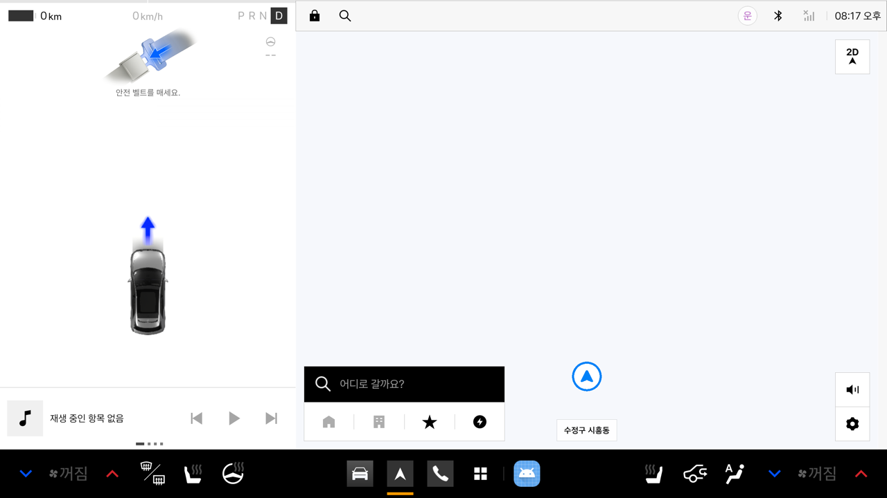 | 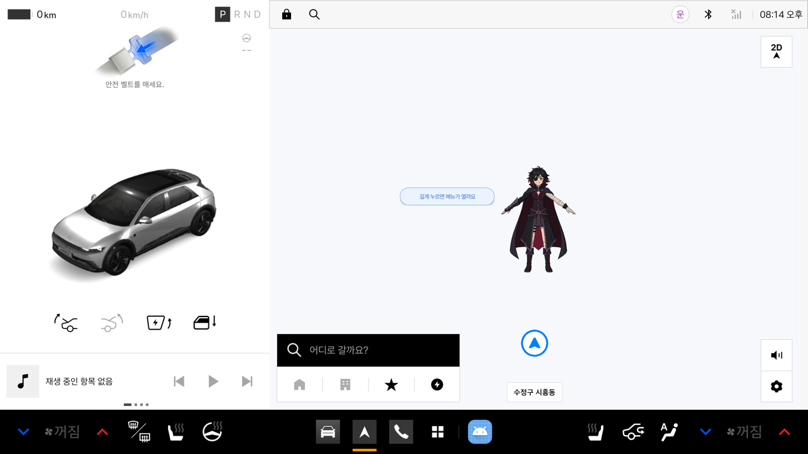 |

## 2. 캐릭터를 누르고 floating controls 열기

| 입력 | 판정 | 반응 |
| --- | --- | --- |
| 짧게 탭 | 홀드/드래그가 아닌 탭 | TOUCH WAV와 해당 캐릭터에 승인된 짧은 동작 |
| 약 500ms 제자리 홀드 | 이동이 없고 홀드 시간이 지남 | 캐릭터 주변 floating buttons 표시. TOUCH는 재생하지 않음 |
| 드래그 | 이동 거리가 tap slop 초과 | 캐릭터 위치 이동/저장. 메뉴/TOUCH는 실행하지 않음 |
| X | 메뉴 또는 sheet 열린 상태 | 현재 메뉴/sheet만 닫고 캐릭터 유지 |
| 주행 또는 상태 미확인 | 언제든지 | 캐릭터와 메뉴/sheet 숨김, 입력 잠금 |

세 제스처는 포인터 입력 하나당 하나만 실행한다. 주행 제한은 제스처보다 우선한다.

**눌림 피드백과 안내**
- 캐릭터를 누르고 있으면 약 0.1초 뒤 캐릭터가 살짝 어두워지고(불투명도 0.8), 떼거나 끌기·길게 누름이 확정되면 원래대로 돌아온다. 짧은 탭에는 보이지 않는다. 길게 누름이 확정되어 메뉴가 열리는 순간 햅틱(LONG_PRESS)을 보낸다.
- "길게 누르면 메뉴가 열려요" 안내(위 오른쪽 화면)는 캐릭터가 나타날 때마다 보여 주되, 메뉴를 한 번이라도 열어 본 사용자에게는 더 보이지 않고, 열지 않았어도 최대 5번까지만 보인다. 몇 초 뒤 사라진다.

**표시·이동 영역**
- 캐릭터·메뉴·시트는 시스템 바(상·하단) 안쪽에서 **왼쪽 driving view(계기판, 안전 벨트 경고 등)를 뺀 영역**에만 있다. 끌어도 이 경계에서 멈추고, 저장된 위치도 불러올 때 이 영역 안으로 맞춘다.
- driving view 폭은 Pleos Connect v2.1.0 AVD 실측(화면 폭 2560의 1/3, 창 [0,0][853,1300])을 상수로 쓴다. Pleos 문서에는 이 폭도, 오버레이를 둘 수 있는 곳도 없다. 화면 종류(Connect-W 등)가 다르면 달라질 수 있어 Pleos 확인 전까지는 더 좁은 쪽(닫힌 쪽)을 쓴다. 영역이 너무 좁아지는 작은 화면에서는 제외하지 않는다.

| 길게 눌러 메뉴 열기 | 드래그로 이동 | 왼쪽 경계에서 멈춤 |
| --- | --- | --- |
| 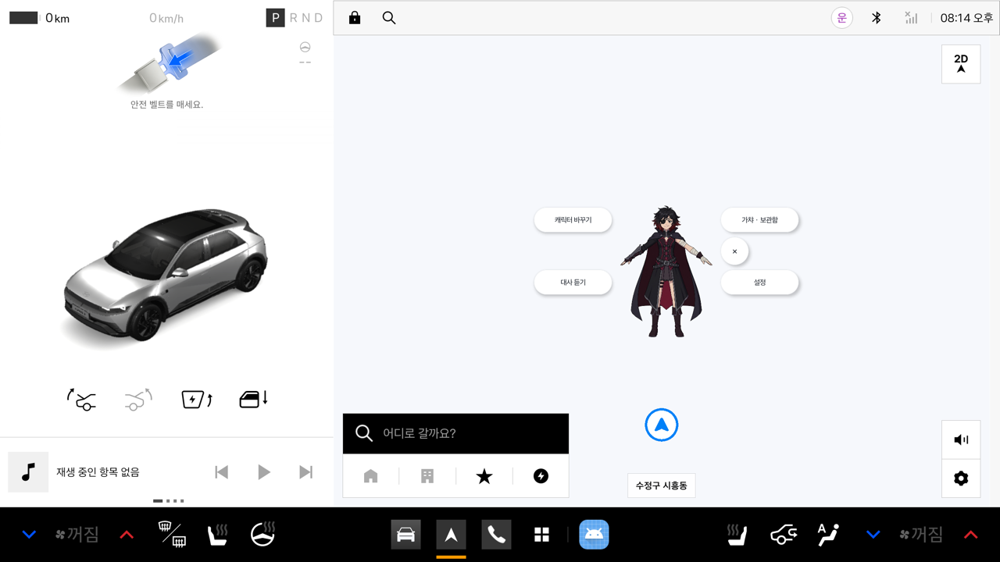 | 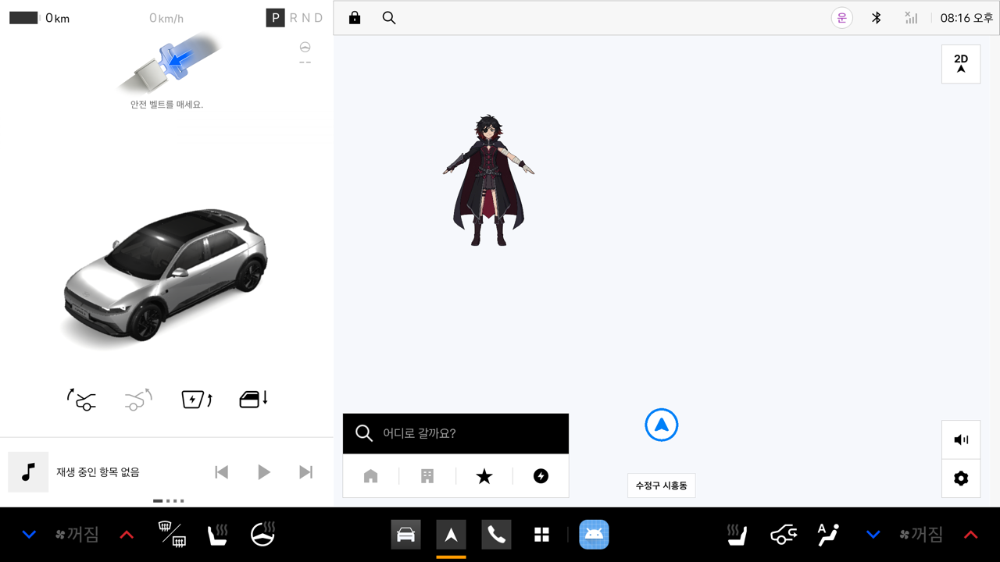 | 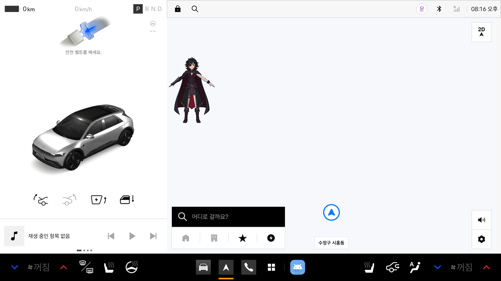 |

**알려진 한계**: 캐릭터 창은 캐릭터마다 보이는 범위에 맞춘 사각형이지만(보이는 범위 + 사방 8dp, 팩별 `overlay` 크기·오프셋), 그 안의 투명한 곳(어깨 옆·다리 사이)도 터치를 받아 그 아래 지도 터치를 막고 아바타 반응을 일으킨다. 앱에서 창을 터치 비대상으로 바꾸면 창 불투명도가 0.8에 고정돼(Android 12+의 최대 가림 불투명도 규칙으로 보임) 캐릭터가 항상 흐려지므로([PLEOS_PLATFORM_FINDINGS](../platform/PLEOS_PLATFORM_FINDINGS.md) 참고) 쓰지 않는다. 팩별 값은 아직 SDK 릴리스 전이고 2D 프리뷰의 범위로 정한 임시 값이다([CHARACTER_PACK_OVERLAY_FRAMING_REQUEST](../architecture/CHARACTER_PACK_OVERLAY_FRAMING_REQUEST.md)).

### 캐릭터 주변 메뉴

1. 캐릭터 바꾸기
2. 가챠 / 보관함
3. 대사 듣기 (시트 제목은 "캐릭터 대사")
4. 설정 (시트 제목은 "캐릭터 설정")
5. X 닫기

배치: 캐릭터 양옆에 자리가 있으면 링으로 둔다(왼쪽에 캐릭터 바꾸기·대사 듣기, 오른쪽에 가챠·보관함·X·설정). 한쪽에만 자리가 있으면 그쪽에 한 줄로 쌓고(아래 왼쪽 경계 화면), 양쪽 다 없으면 여유가 많은 쪽에 쌓은 뒤 안전 영역 안으로 맞춘다. 캐릭터는 가리지 않는다. 기준 위치는 캐릭터 팩 SDK가 GLB 머리 anchor를 아직 주지 않아(0.3.3~0.3.8) 오버레이 창 경계를 쓴다(이슈 #37의 model bounds fallback). 메뉴와 시트는 Pleos 상태 바·차량 제어·시스템 바를 가리지 않는 안전 영역 안에 둔다.

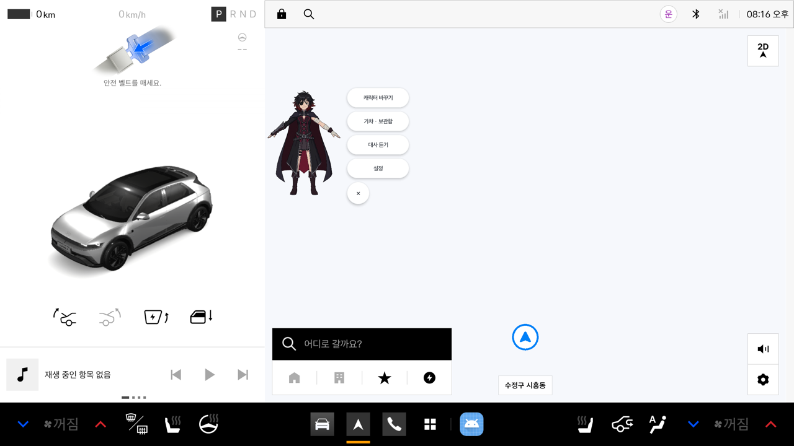

## 3. 메뉴별 overlay 흐름

시트는 TDS(Toss Design System) 기준의 compact overlay다([DESIGN_SYSTEM](../../android/DESIGN_SYSTEM.md)의 "오버레이 시트 — TDS 기준"). 각 시트는 오른쪽 위 X로 닫는다.

### 캐릭터 바꾸기

1. 기본 5개와 가챠 후보를 compact overlay sheet로 보여 준다. 기본 5개는 "보유"(장착 중인 것은 "장착 중"), 가챠 후보는 "잠김"으로 나온다.
2. 기본 캐릭터 5개는 선택 가능하고, 미보유 가챠 캐릭터는 잠금 상태를 보여 준다.
3. 새 캐릭터를 고르면 캐릭터와 voicePack을 함께 바꾼다. 캐릭터마다 창 크기가 다르면 창을 새로 만든다. 에뮬레이터에서는 0.8초 안에 새 캐릭터로 바뀌었다. SWITCH_OUT/IN 연출과 두 음성이 겹치지 않는 것은 이 캡처로 확인하지 못했다.

| 캐릭터 바꾸기 시트 | 교체 후 (다른 크기의 창) |
| --- | --- |
| 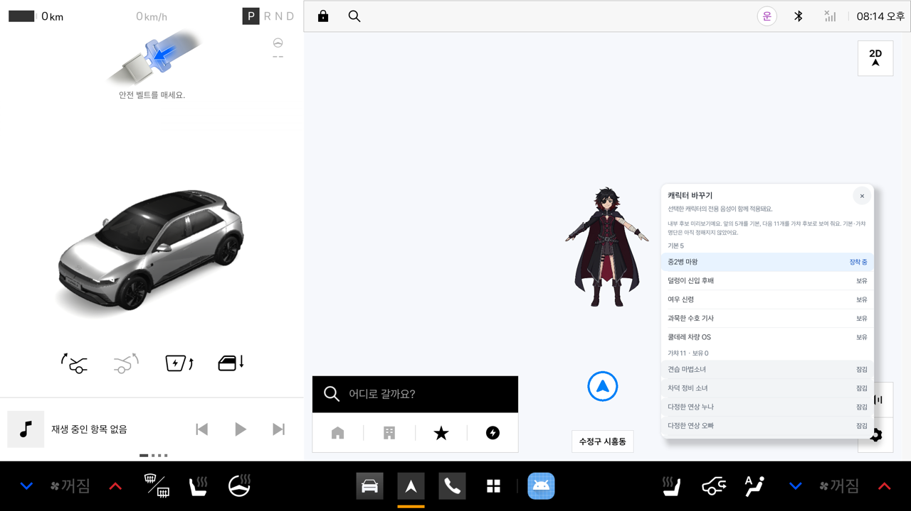 | 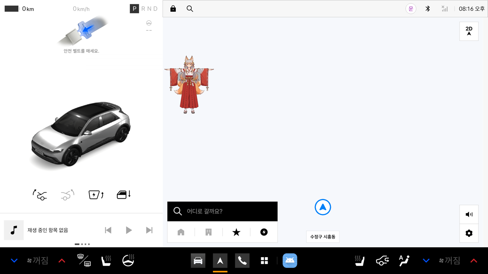 |

### 가챠 / 보관함

1. 첫 후보 11개와 보유 여부("보유 0 / 11", "미보유", 아직 정해지지 않은 슬롯은 "미정·비어 있음")를 compact overlay sheet에서 확인한다.
2. 뽑기 결과는 보유 목록에 등록하는 제안 흐름이다. 보유와 장착은 별개다.
3. 뽑기 비용·확률·중복 규칙이 결정되기 전에는 결제, 재화, 확률 숫자를 보여 주지 않는다. "뽑기" 버튼은 막혀 있고 "뽑기는 획득 정책이 정해지면 열려요."라고 안내한다.
4. PRD 목업의 추첨은 시각 시연이며 실제 소유권/결제 결과를 만들지 않는다.

### 대사 듣기 / 설정

- 대사 목록은 선택 캐릭터의 고정 자막과 WAV를 1:1로 연결한다(인사말, 브레이크, 방향지시등 …). 문장 편집이나 별도 음성팩 선택은 제공하지 않는다.
- 사용자가 대사 행의 "듣기"를 누르면 정차 중 해당 캐릭터 WAV를 재생한다.
- 설정은 짧은 항목만 compact overlay로 제공한다: "세션 시작 인사" 스위치(정차 중 캐릭터가 처음 나타날 때 한 번 인사)와 "캐릭터 위치 초기화" 버튼. 캐릭터 표시를 끄는 스위치는 다시 켤 방법이 없어져 두지 않았다.

| 가챠 · 보관함 시트 | 캐릭터 대사 시트 | 캐릭터 설정 시트 |
| --- | --- | --- |
| 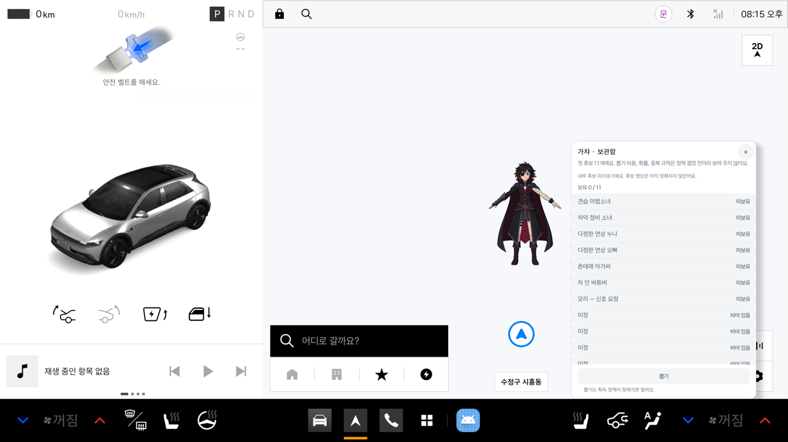 | 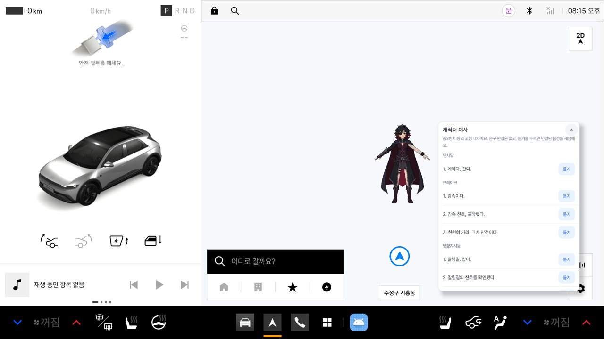 | 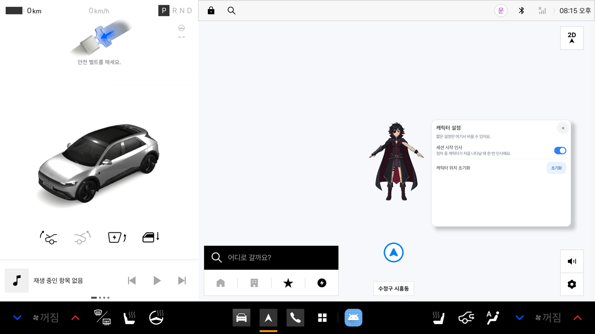 |

## 4. 주행 및 예외 흐름

| 조건 | 처리 |
| --- | --- |
| 차량 상태 미확인 | 주행으로 간주하고 overlay 조작을 표시하지 않음 |
| 주행 규제 시작 | 캐릭터·floating menu·sheet를 즉시 숨기고 수동 WAV/가챠/교체를 중단 또는 보류 |
| 정차 복귀 | 기어를 P로 돌리면 캐릭터가 마지막 위치에 다시 나타남(아래 오른쪽 화면). |
| 오디오 포커스 거절 | WAV가 재생된 것으로 기록하지 않고 재시도/보류 상태 표시 |
| 캐릭터/voicePack 손상 | 다른 캐릭터 파일로 조용히 대체하지 않고 준비 상태와 이유 표시 |
| overlay 사용 불가 | 현재 HMI를 유지하고 overlay 상태를 기록. Activity가 없어 사용자가 직접 여는 복구 화면은 아직 없다(미정) |
| 시작 hook 미지원 | 점화/부팅 성공을 추정하지 않는다. 수동 복구 진입점은 위와 같이 미정 |

기존 차량 신호는 앱에서 새로 만들지 않는다. Virtual Console이나 차량이 보내는 값을 Pleos Vehicle Service callback으로 받고 기존 이벤트 정책을 적용한다.

| 기어 D: 숨김 | 기어 P: 다시 나타남 |
| --- | --- |
|  | 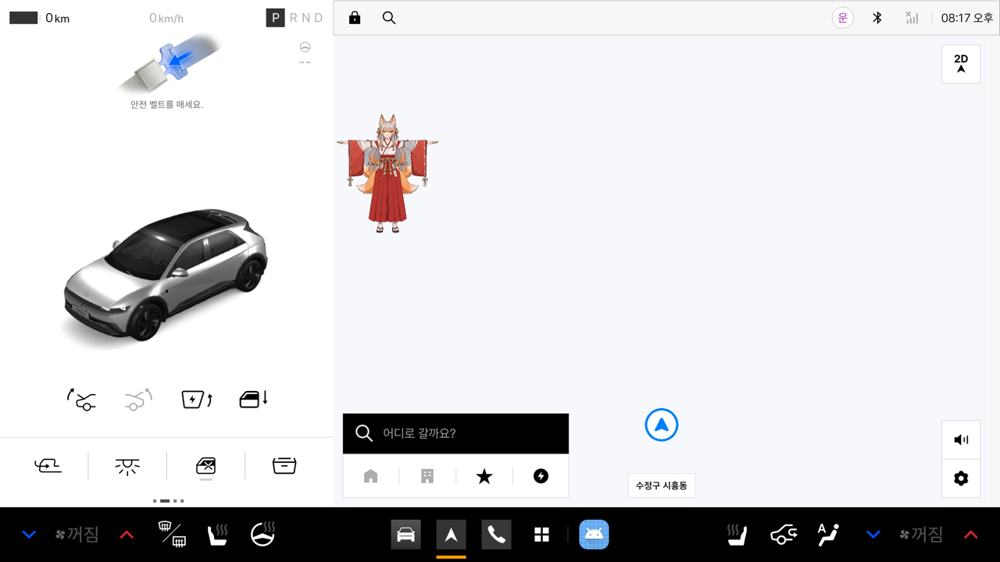 |

## 5. 구현·검증 경계

- 구현되어 에뮬레이터에서 화면으로 확인한 것: 캐릭터 overlay(표시·드래그·경계), 길게 눌러 여는 floating 메뉴, 네 개의 시트, 캐릭터 교체, 주행 시 숨김과 정차 복귀, 길게 누름 안내. 가챠의 "뽑기"는 정책 결정 전이라 막혀 있다.
- 에뮬레이터 개발 검증은 `adb appops`로 overlay를 켠 AVD 범위다. 이는 앱 동작 확인이지 Pleos 제품 권한이 공식 승인됐다는 증거가 아니다.
- 앱에는 Activity가 없다. Pleos가 제공하는 자동 시작 진입점, 사용자/프로세스 생명주기, overlay 권한의 배포 후 지속 여부는 확인하지 못했다.
- 3D 모델 렌더링, 음성 재생, 눌림 어두워짐은 위 캡처에 담기지 않았다. 3D는 에뮬레이터에서 보이지 않아 실제 기기 확인이 필요하다.
- Android 구현 시 WindowManager overlay가 시스템/긴급 안내보다 우선하지 않도록 하고, 주행 상태 변경에서 숨김 처리를 검증한다.

## 캡처 재현 방법

1. `adb forward tcp:8088 tcp:8088` 후 `http://127.0.0.1:8088/`을 브라우저로 한 번 열어 둔다(안 열면 REST가 503).
2. 정차: `PUT /vehicle/gear?gear=P`, 주행: `PUT /vehicle/gear?gear=D`.
3. 길게 누름은 `adb shell input swipe x y x y 800`(제자리 800ms), 드래그는 `input swipe`로 좌표를 옮긴다. 화면은 `adb exec-out screencap -p`.
4. 안내를 보려면 캐릭터가 나타난 직후 몇 초 안에 캡처한다. 안내 횟수는 앱 설정(`overlay.menuHint.count`, `overlay.menu.opened`)으로 정해진다.

자세한 절차는 [PLEOS_VIRTUAL_CONSOLE_E2E](../guides/PLEOS_VIRTUAL_CONSOLE_E2E.md)를 본다.

## 관련 문서

- [제품 요구사항 v2](PRODUCT_REQUIREMENTS.md)
- [WindowManager overlay-first 와이어프레임](WIREFRAMES.md)
- [overlay-first 인터랙티브 목업](mockups/voice-companion-flow.html)
- [33개 캐릭터 음성 대상](../content/RELEASE_VOICE_CHARACTER_PLAN.md)

## 구현 추적 이슈

- [#36 Pleos 시작 진입점과 Activity 없는 overlay runtime](https://github.com/DrivePersona/Vroomi/issues/36)
- [#37 floating controls 및 캐릭터 관리 overlay sheet](https://github.com/DrivePersona/Vroomi/issues/37)
- [#38 Pleos AVD UI/lifecycle 검증과 PR 증적](https://github.com/DrivePersona/Vroomi/issues/38)
- [#39 첫 가챠 풀 획득 정책](https://github.com/DrivePersona/Vroomi/issues/39)
